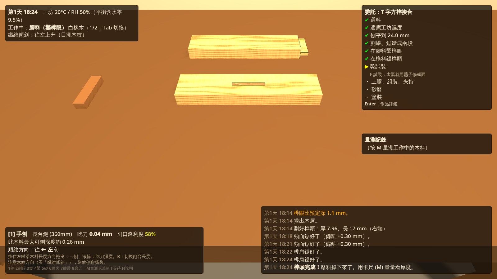
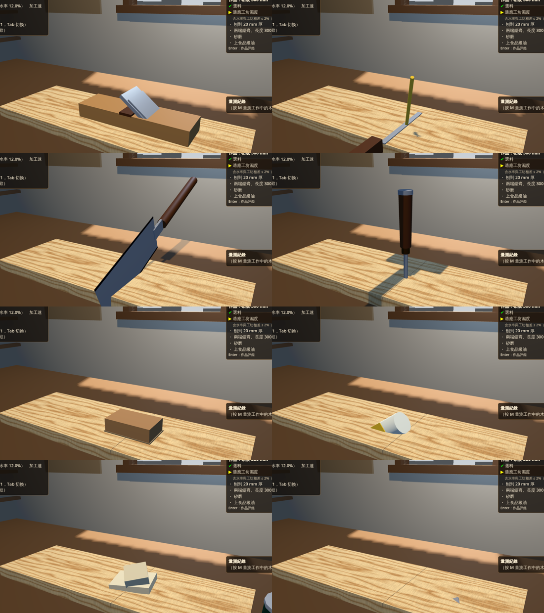

# 木匠工坊 Woodcraft（Godot 4 原型）

追求寫實的第一人稱木工模擬 + 小工作室經營。

**遊戲循環**：在工作室用手工具做作品 → 拍照上架到「拾木市集」（虛構的手作平台）或交給客戶訂單 → 賺錢買木料（價格每天波動）→ 之後買更好的工具、修繕工作室

目前的作品：
- **砧板**（可販售）：選料 → 適應濕度 → 刨到厚度 → 兩端鋸齊 → 砂磨 → 食品級油
- **T 字方榫接合**（練習件）：刨平 → 劃線 → 鋸斷 → 鑿榫眼 → 鋸榫頭 → 試裝修削 → 上膠夾持 → 砂磨 → 塗裝



## 執行

1. 安裝 [Godot 4.3+](https://godotengine.org/download)（標準版即可，不需要 .NET）
2. Godot → 匯入 → 選 `project.godot` → 執行 (F5)
3. 可選：把 `NotoSansTC-Regular.ttf` 放到 `assets/fonts/` 讓中文字更好看

自動化測試（模擬玩家：做完 T 字榫練習件、兩塊砧板、交訂單、上架、過一週看銷售與評價、存讀檔）：

```bash
godot --headless --import
```

```bash
godot --headless res://tests/sim_test.tscn
```

其他測試：`tests/tool_shots.tscn`（工具模型截圖）、`tests/window_shots.tscn`（窗外日夜截圖）、`tests/export_sfx.gd`（匯出音效試聽）

存檔位置：Godot 的 `user://save.json`（睡覺、完成作品、關閉視窗時自動存檔）

## 操作

| 按鍵 | 功能 |
|---|---|
| L | 木料架：挑料、選作品、開始製作；或把工作台上的料收回 |
| P | 電腦：拾木市集（上架）、客戶訂單、木料行、評價與收支 |
| Z | 睡覺（17:00 以後），醒來是隔天 07:00，自動存檔 |
| 滾輪 | 放大縮小畫面 |
| Ctrl+滾輪 / Alt+滾輪 | 調整工具的主要 / 次要數值（吃刀深、鑿寬、砂紙號數…） |
| F2 | 切換加工速度 ×1（真實）/ ×2 / ×3（預設）/ ×5 |
| 右鍵拖曳 / WASD / Space、C | 轉頭 / 移動 / 升降 |
| 1–8 | 手刨、劃線、鋸、鑿、砂紙、膠與夾具、塗裝、磨刀石 |
| 左鍵 | 使用工具（各工具操作方式見畫面左下） |
| R | 切換工具模式（鋸齒面、劃線模式…） |
| Tab | 切換工作中的木料 |
| M | 量測：游標卡尺、直尺、水分計（花 1 分鐘遊戲時間） |
| F | 乾試裝 / 上膠後組裝 |
| E | 撬出榫眼木屑 |
| K | 劃線規直接對準目前鑿子寬度 |
| T / Shift+T | 快轉 10 分鐘 / 1 小時（時間平常就會自然流動：1 秒 = 1 分鐘） |
| B | 清掃工作台上的刨花和木屑 |
| Enter | 作品評鑑 |
| H | 操作說明 |

## 已實作的寫實機制

**木材物理**（`scripts/core/wood_physics.gd`、`scripts/data/wood_species.gd`）
- 5 種木材，Janka 硬度、密度、弦向/徑向收縮率、劈裂與逆紋撕裂傾向都取自木材手冊的近似值
- 含水率會依厚度平方律趨近工坊平衡含水率；板寬（弦向）、板厚（徑向）分別脹縮
- 用沒乾的料加工，之後會翹曲、榫頭會變鬆；塗裝能減緩、但無法阻止水分交換

**工具手感**
- 手刨：木料厚度是沿長度的剖面，**鉋台架在高點上只削高點**，長鉋台會自然把料刨直；逆紋刨會撕裂；吃刀太深會卡刀
- 鋸：拉鋸切削、推回不切；縱切齒/橫切齒要對纖維方向；起鋸前 2mm 最容易跑偏；拉太快會跳鋸；**0.6mm 鋸路要鋸在線的廢料側**，否則榫頭薄掉一個鋸路
- 鑿：蓄力敲擊，手晃會撐寬榫眼壁；木屑要撬出來；太靠近端部用力敲會劈裂
- 刃口鋒利度會隨使用磨耗（硬木磨得更快），要依序用 #1000 → #6000 磨刀石研磨

**榫卯配合**：榫眼寬 − 榫頭厚的差值決定 過緊 / 緊 / 剛好 / 略鬆 / 鬆垮；過緊硬敲會撐裂，太鬆白膠填不了縫

**音效**（`scripts/audio/sound_engine.gd`，全部程序化合成，不需要音檔）
- 刨：鋒利的刀是順滑的「唰——」，鈍刀聲音悶、夾雜撕裂的劈啪聲；吃刀太深會聽到顫刀聲
- 連續聲經過兩階低通、柔和飽和與總低通（約 4 kHz），頻譜重心約 2 kHz，不會有刺耳的嘶聲或削波
- 鋸：嗡嗡聲的頻率等於鋸齒通過的速度；鋸齒選錯聲音會變粗糙；拉太快會聽到跳鋸
- 木槌：硬木音高較高，榫眼越深聲音越悶；劈裂時會聽到斷裂聲
- 砂紙粗細、磨刀石、擠膠、夾具、擦油、劃線、清掃都有各自的聲音
- 試聽：`docs/sfx_preview/`。想換成真實錄音，把 `assets/sfx/<名稱>.wav` 放進去即可

**工具實體**（`scripts/fx/tool_models.gd`）
- 8 種工具都有 3D 模型：游標在木料上時放到作業位置，否則拿在手上（畫面右下）
- 手刨沿著刨削行程推；鋸子放進鋸路、隨進度下沉、隨拉鋸來回；鑿子立在游標處，木槌蓄力時從側面舉起、放開時敲下；夾持中的 F 夾留在作品上



**加工速度**：`WoodPhysics.work_speed`（F2 切換，存在存檔裡）。鋸、砂、磨刀完整套用倍率；刨與鑿套用一半，避免一刨／一敲的量大到失去手感

**木屑**（`scripts/fx/workshop_fx.gd`）
- 刨花厚度 = 實際吃刀深度、長度 = 刨削行程；刀鋒利又順紋會捲出一整條，鈍刀或逆紋會碎成片
- 鋸屑：縱切出粗屑、橫切出細粉，在料旁堆成小堆，大小等於鋸掉的木料體積
- 鑿屑、撬出的木屑、榫頭鋸完掉下來的廢料、砂磨粉塵

**工作室與日夜**（`scripts/world/day_night.gd`）
- 太陽從窗外照進來，在工作台上投下光斑；月亮有月相；入夜後工作燈成為主要光源

**工序**：白膠開放時間 10 分鐘、至少夾 45 分鐘；夾太緊會把膠擠光；砂紙跳號會很慢、橫紋砂會留痕；塗裝會讓砂痕、膠痕、撕裂、鉛筆線全都浮現

## 經營系統

- **時間**：1 真實秒 = 1 遊戲分鐘，開選單時暫停；調整 `scripts/main.gd` 的 `TIME_SCALE`
- **工坊濕度**：台灣室內約 25°C / RH 65%，平衡含水率 12%；窯乾材（8%）進來要先放著適應
- **木料行**：5 種樹種 × 寬板／角料 × 窯乾／風乾，價格每天以均值回歸隨機漫步波動
- **拾木市集**：作品評鑑後收進庫存，自動拍商品照；建議售價 = 材料與工時 × 評分 × 店舖評價 × 本週熱門；訂價越高越難賣，平台抽成 15%
- **客戶訂單**：每天可能收到新詢問（評價越高越多），有規格與交期；逾期一星負評
- **延遲評價**：作品到買家手上幾天後才評價——含水率沒平衡會翹、砧板用了非食品級塗料、瑕疵、價格過高都會反映在星等

## 專案結構

```
scripts/
  main.gd              工坊主控：場景、輸入、遊戲時間、組裝與膠合
  data/wood_species.gd 木材資料（加新樹種只要加一筆）
  core/wood_physics.gd 所有物理公式（調手感改這裡）
  core/wood_piece.gd   木料：厚度剖面、含水率形變、CSG 視覺（榫眼、榫頭、鋸路）
  core/game.gd         經濟、市集、訂單、木料行情、評價、存檔（autoload：Game）
  core/workflow.gd     作品專案基底類別與作品清單
  core/projects/       各作品：cutting_board.gd、mortise_tenon.gd
  tools/*.gd           8 種工具，皆繼承 work_tool.gd
  ui/hud.gd            介面
  ui/computer_ui.gd    電腦：拾木市集
  ui/rack_ui.gd        木料架
  audio/sound_engine.gd 程序化音效
  fx/workshop_fx.gd    刨花、鋸屑、鑿屑、廢料、粉塵
  world/day_night.gd   工作室、窗戶、日夜
shaders/wood.gdshader  程序化木紋（可換成 GPT 貼圖）
tests/sim_test.gd      整合測試
docs/ART_PROMPTS.md    GPT 美術素材提示詞與掛載路徑
```

## 美術素材

見 [`docs/ART_PROMPTS.md`](docs/ART_PROMPTS.md)：每張圖都有可直接複製的提示詞和放置路徑，放進去就自動套用。

## 下一步

工作室生活、網路販售、工具與工作室升級的完整規劃見 [`docs/ROADMAP_ECONOMY.md`](docs/ROADMAP_ECONOMY.md)。

其他：
1. **3D 工具模型與手部動畫**：工具跟著滑鼠動作（目前只有 HUD 文字回饋）
2. **更多委託**：鳩尾榫抽屜、四腳方凳（需要多組榫卯 + 對角線檢查方正）
5. **讀木紋選料**：從料架上看端面年輪判斷弦切/徑切，影響形變
6. **木工夾台、翻面**：刨另一面、刨邊、檢查扭曲 (winding sticks)
